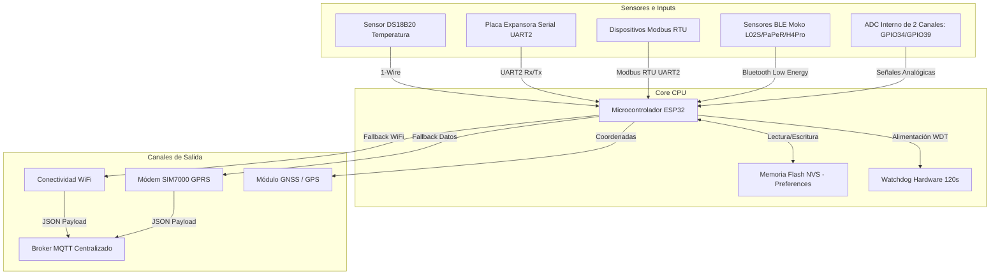
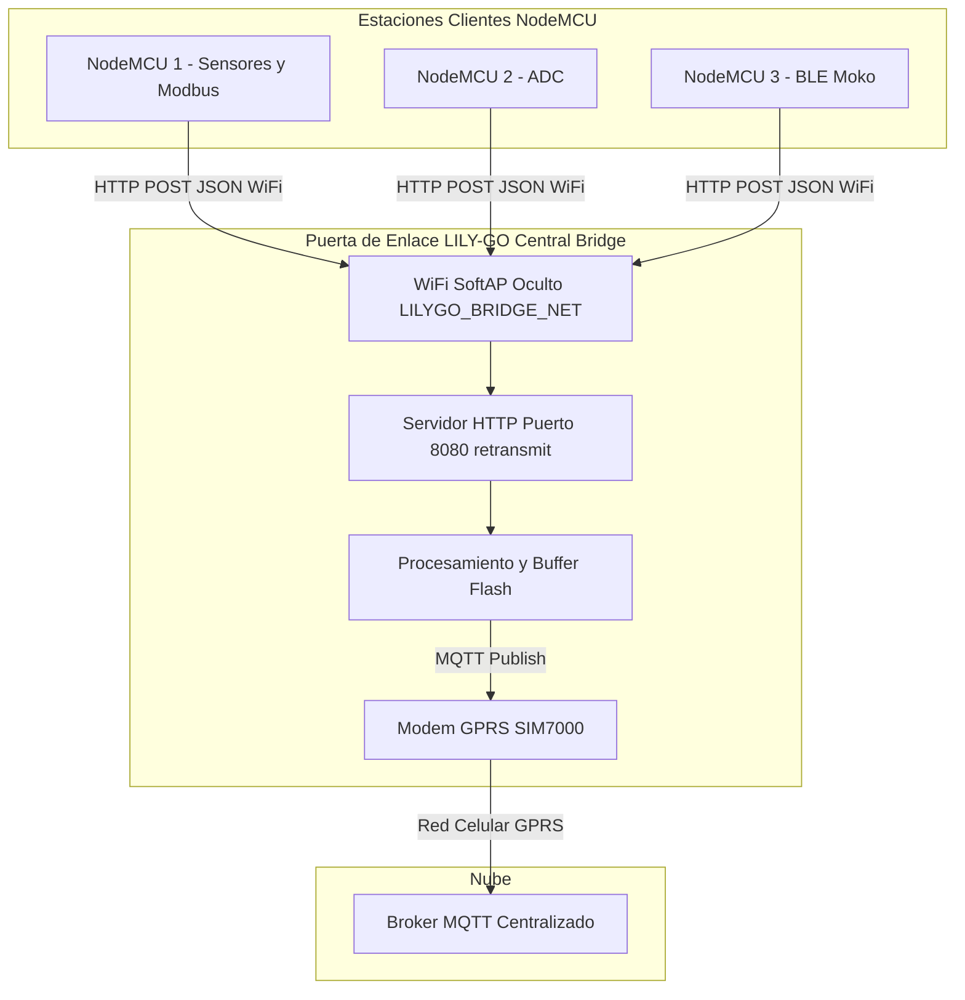

# Documento de Requisitos de Producto (PRD) - LILY-GO Telemetry Device

Este documento detalla los requisitos, arquitectura, componentes y especificaciones del firmware para el dispositivo de telemetría y monitoreo **LILY-GO** (basado en el microcontrolador ESP32 y el módem celular SIM7000).

## 1. Introducción y Objetivos
El objetivo principal del dispositivo es recopilar datos de múltiples fuentes de sensores industriales y ambientales, procesarlos localmente y transmitirlos de manera confiable a un broker centralizado MQTT a través de una arquitectura de red dual inteligente (WiFi y GPRS celular).

El dispositivo está diseñado para operar en entornos remotos o móviles donde la conectividad puede ser inestable, ofreciendo mecanismos avanzados de almacenamiento persistente local, geolocalización y tolerancia a fallos.

## 2. Arquitectura de Bloques del Sistema

El siguiente diagrama ilustra el flujo de datos entre los distintos módulos de hardware controlados por el firmware:



## 3. Requisitos de Hardware y Conectividad

### 3.1 Procesador y Almacenamiento
*   **Microcontrolador:** ESP32 (Soporte Dual Core, temporizador por hardware, bajo consumo).
*   **Watchdog por Hardware:** Watchdog Timer (WDT) configurado a **120 segundos** para reinicio en caso de cuelgues de red o del procesador.
*   **Persistencia (NVS):** Uso de la biblioteca `Preferences` para el almacenamiento en memoria Flash de la configuración persistente (SSID, contraseña, IP del Broker, APN, ID del equipo, calibración del ADC y habilitaciones de módulos).

### 3.2 Modos de Conectividad de Red y AP Bridge (Smart Switching)
El firmware gestiona dos interfaces de red físicas (WiFi y GPRS celular) y permite tres modos de conectividad mediante el parámetro `en_wifi` persistido en la flash NVS:
1.  **Modo 0 (WiFi Deshabilitado):** La radio WiFi se apaga por completo. El canal de comunicación de telemetría y diagnóstico del dispositivo opera única y exclusivamente a través del módem celular GPRS (SIM7000).
2.  **Modo 1 (WiFi Cliente / STA):** Es el modo preferido para comunicación de bajo costo. El equipo actúa como cliente (STA) e intenta conectarse a la red WiFi local cuyas credenciales se encuentran en la flash. Si la conexión WiFi o al Broker MQTT falla, conmuta automáticamente a la red móvil GPRS como respaldo de datos.
3.  **Modo 2 (AP Bridge / SoftAP):** El equipo actúa como Hub o Gateway local (ver Sección 6), levantando una red WiFi local oculta para recibir y retransmitir los datos de hasta 10 estaciones NodeMCU cliente. En este modo, el canal de salida al Broker MQTT externo se rutea permanentemente por el módem celular GPRS.
4.  **Monitoreo de Enlace:** En caso de que se pierda la conexión MQTT por más de **5 minutos** (MQTT_TIMEOUT), el sistema fuerza un ciclo de reconexión profunda o reinicio de los periféricos asociados.

## 4. Módulos y Funcionalidades del Firmware

El dispositivo cuenta con un diseño de firmware modular habilitable bajo demanda mediante comandos de configuración:

### 4.1 Sensor Local 1-Wire (DS18B20)
*   Monitoreo directo de temperatura ambiente o de fluidos.
*   *Exclusión:* Se lee de manera periódica cada 5 segundos si está habilitado mediante `en_sensor=1`.

### 4.2 Puerto Serial Secundario y Placa Expansora
*   UART2 dedicada (Pines RX=GPIO32, TX=GPIO33) a una tasa por defecto de 4800 baudios.
*   Permite enviar tramas crudas hacia la expansora y recolectar las respuestas estructuradas en variables indexadas del sistema (`S0` a `S15`).
*   Se incluye un comando de reinicio físico de la expansora (`DVL+EXP_RESET`) mediante el pin `SENSOR_POWER_PIN`.

### 4.3 Red de Sensores Bluetooth (BLE Moko)
*   Escaneo periódico de balizas BLE usando `NimBLE` (ventanas de 5 segundos, con intervalo de 30 segundos entre inicios).
*   Decodificación nativa de tramas propietarias del fabricante **Moko** (modelos de sensores `L02S`, `PaPeR`, `H4Pro`).
*   En H4 Pro, el anuncio con nombre `DVL` o `PaPeR` valida la MAC durante el escaneo aunque llegue en otro slot; solo se publica la trama de temperatura/humedad `0x70`. Las tramas `0x40`, `0x50` y `0x60` no generan otro JSON que desplace esa medicion. Si no se detecta `0x70` en ese escaneo, no hay reporte H4. MOKO Door mantiene su decodificación independiente mediante manufacturer data y trama `0x81`.
*   Dentro de un escaneo se conserva la última lectura de cada MAC y tipo de trama: los anuncios repetidos de L02S/EA01 y H4 Pro `0x70` no producen varios reportes del mismo sensor.
*   En L02S con service data `EA01`, el JSON BLE incluye `door` (`0` cerrado, `1` abierto) y `door_open` (`false`/`true`) según el bit de estado recibido. Esto informa el estado en cada lectura publicada; no agrega un disparo inmediato por cambio entre escaneos.
*   Extracción dinámica de: nivel de batería de los tags, temperatura, humedad relativa, estado de movimiento, aceleración en 3 ejes (X, Y, Z) e información de proximidad (UUID/Major/Minor).

### 4.4 Canal de Telemetría Modbus RTU
*   Implementación de comandos Modbus Master sobre el puerto serial secundario.
*   Permite configurar hasta **25 consultas** (`idx` 1-25), ejecutadas secuencialmente: una cada 2 segundos como mínimo y 200 ms de espera de respuesta. Cada consulta identifica ID de esclavo, función, dirección inicial y cantidad.
*   Cada consulta publica también al recibir su primera respuesta válida o cuando cambian sus bytes de datos (datos_hexa) respecto de la última respuesta válida de ese idx. Una respuesta igual actualiza date_respuesta sin disparar otro envío; timeout, trama inválida o excepción no disparan el evento. Se conserva el mismo JSON y topic por idx. La publicación periódica por DVL+STIME y el keep-alive siguen independientes. Si el evento no puede publicarse, se intenta encolar en la flash existente, con su límite de 511 bytes por mensaje y su capacidad finita; los paquetes más antiguos pueden sobrescribirse al llenarse la cola. El evento se procesa antes de la siguiente consulta, sin esperar STIME. `DVL+SENVIO_MODBUS=DIRECTO|COLA` y `DVL+QENVIO_MODBUS` permiten seleccionar y consultar solo el orden de salida Modbus; `DIRECTO` conserva el comportamiento previo y es el valor inicial. `COLA` agrega al historico pendiente tanto eventos como reportes periodicos, sin cambiar la descarga ni otros sensores.
*   Baud compartido de UART2 mediante `DVL+SBAUD`; paridad Modbus persistente mediante `DVL+SPARITY_MODBUS=NONE|EVEN|ODD`, consultable con `DVL+QPARITY_MODBUS`. Cada comando conserva el otro parámetro. Modbus utiliza 8N1, 8E1 u 8O1; serial común utiliza 8N1.
*   Conserva en RAM la última respuesta válida de cada consulta, sus datos y fecha UTC de recepción. Los fallos de lectura no reemplazan estos valores. Reiniciar, reconfigurar o borrar una consulta limpia su lectura; cambiar baud o paridad limpia las lecturas de todas las consultas. Los paquetes históricos guardados en flash se conservan.
*   *Exclusión Mutua:* La habilitación de Modbus (`en_modbus=1`) apaga de forma segura el módulo Serial Secundario ordinario para evitar conflictos en la UART2 compartida.

### 4.5 Módulo de Lectura Analógica (ADC)
*   Monitoreo de **2 canales analógicos** independientes: ADC0 en GPIO34 y ADC1 en GPIO39.
*   **Calibración Dinámica:** Factores de conversión lineales e individuales (pendiente $m$ y offset $p$) mediante la fórmula:
    
    `Valor Calibrado = (Lectura Cruda * m) + p`
*   **Filtros de Descarte:** Umbrales mínimos configurables. Si la lectura es inferior a un valor umbral, el firmware la sustituye por un valor estático por defecto (útil para eliminar ruido en cero).
*   **Alisado (Promedio Móvil):** Muestreo acumulado (por defecto de 50 mediciones) antes de publicar un dato estabilizado.

### 4.6 Motor de Eventos Programable (Micro-PLC)
*   Evaluador determinístico de **4 reglas** (`EV0` a `EV3`) ejecutado cada `100 ms` con persistencia en Flash NVS (`Preferences`) y temporizador de confirmación continua **TON** (`0` a `86400` segundos).
*   **Fuentes soportadas (`<src>`):**
    *   Alimentación y ADC: `VPRIN` (`GPIO36`), `VBACK` (`GPIO35`), `ADC0` (`GPIO34`), `ADC1` (`GPIO39`).
    *   Digitales y enlace: `DI1` (`GPIO13`), `DI2` (`GPIO14`), `COMM` (estado MQTT).
    *   Sensores cableados: `TEMP` (DS18B20) y `S0`..`S15` (expansora serial).
    *   Sensores inalámbricos BLE Moko (con filtrado opcional por dirección MAC completa o últimos 4 caracteres hex `:<mac>`): `BLE_DOOR[:<mac>]`, `BLE_MOV[:<mac>]`, `BLE_TEMP[:<mac>]`, `BLE_HUM[:<mac>]`, `BLE_BAT[:<mac>]`.
    *   Salud ESP32: `TEMP_MCU`, `HEAP`, `BTN` (`GPIO0`).
    *   Disparadores horarios (`DT0` a `DT3` configurables por `DVL+SDT=<0..3>,<fecha_hora|0>`): admiten fecha puntual (`YYYY-MM-DD HH:MM:SS`), horario diario (`HH:MM:SS`) y comodines (`*`).
*   **Acciones y rearme:** `MQTT`, `OUT:<pin>:HIGH`, `OUT:<pin>:LOW`, `OUT:<pin>:PULSE:<seg>`, `CYCLE_PWR` (`GPIO23`) y `RESTART`; con modos `ONESHOT` y `REPEAT:<seg>`. Configurables mediante `DVL+SEVT`, `DVL+QEVT` y `DVL+EVT_STATUS`.

### 4.7 Sincronización de Reloj UTC (`ClockSync`)
*   Módulo unificado (`ClockSync.h/.cpp`) encargado de mantener el RTC del ESP32 estrictamente en **UTC** sin depender de `+CCLK` ni zonas horarias NITZ locales del módem.
*   En modo celular (`GSM`) opera de forma **no bloqueante** con jerarquía de fuentes `RED (*PSUTTZ) < GPS < NTP (+CNTP modo 1)`. Al validar `+CNTP:` vía URC en UTC puro, aplica reintento cada `60 s` ante fallo y resincronización cada `8 horas` tras éxito. En modo `WiFi` opera en paralelo mediante `updateClockFromNTP_wifi()` en `Fechayhora.cpp`.

## 5. Protocolo de Telemetría (MQTT JSON Payloads)

Todos los reportes periódicos enviados al Broker MQTT (tópico base: `DVL/LILY-GO/<ID_LILY>`) se estructuran en formato JSON. Dependiendo de los módulos activos, el firmware transmite diferentes payloads:

### 5.1 Payload Estándar / Serial Secundario
```json
{
  "topic": "DVL/LILY-GO/OBU_123",
  "ident": "OBU_123",
  "S0": "12.5",
  "S1": "45.0",
  ...
  "S15": "0.0",
  "date": "2026-06-04 16:04:00",
  "latitud": "-34.6037",
  "longitud": "-58.3816",
  "Tension_backup": 4.208701,
  "Tension_principal": 5.08,
  "Version": "V07.19.10",
  "index": 482
}
```

### 5.2 Payload Modbus RTU
```json
{
  "topic": "DVL/LILY-GO/OBU_123/MODBUS/3",
  "ident": "OBU_123",
  "baud": 4800,
  "paridad": "EVEN",
  "consulta": "01 03 00 24 00 02 84 00",
  "respuesta": "01 03 04 17 EB 06 99 4C 79",
  "datos_hexa": "17EB0699",
  "date_respuesta": "2026-06-04 16:03:55",
  "date": "2026-06-04 16:04:00",
  "latitud": "-34.6037",
  "longitud": "-58.3816",
  "Tension_backup": 4.208701,
  "Tension_principal": 5.08,
  "Version": "V07.19.10",
  "index": 483
}
```

Cada consulta configurada se publica por separado en
`DVL/LILY-GO/<ID_LILY>/MODBUS/<idx>`. El sufijo es la ranura de consulta,
no el ID del dispositivo. En el ejemplo, idx 3 consulta al dispositivo ID 1.
Consultas idénticas o dirigidas al mismo dispositivo tienen mensajes independientes.
El receptor debe adaptar su interpretación de los tópicos y campos al nuevo formato;
los paquetes históricos pendientes conservan el formato con que fueron guardados.

`consulta` y `respuesta` incluyen las tramas completas con CRC y espacios.
`datos_hexa` contiene solamente los bytes de datos, en mayúsculas y sin espacios.
La Lily no interpreta el tipo numérico ni reordena palabras: esa conversión
corresponde a la plataforma. `date_respuesta` indica el momento de recepción de
la última respuesta válida; `date`, el armado del mensaje. Ante timeout, CRC
incorrecto, longitud incorrecta, excepción o ID no coincidente se conserva la
lectura válida anterior. Sin lectura válida previa, respuesta, datos y fecha
se publican vacíos. Una lectura válida recibida sin fecha de reloj admisible
(2024-2099) se guarda con `date_respuesta` vacía, sin completarla retroactivamente.

El límite offline sigue siendo 511 bytes de contenido por mensaje. La cantidad
de consultas aumenta el número de mensajes por intervalo, no ese límite individual.
La recepción actual no separa tramas acumuladas ni elimina bytes pendientes antes
de transmitir; las respuestas tardías requieren una revisión aparte. No se agregó
un comando de timeout ni se modificaron los tiempos para esta versión.

### 5.3 Payload de Diagnóstico (Keep-Alive)
Emitido periódicamente según el intervalo configurado en Flash con `DVL+SKA=<seg>` / `DVL+QKA` (**900 segundos** por defecto), con información técnica del módem y estado de la red celular:
```json
{
  "topic": "DVL/LILY-GO/OBU_123",
  "status": "keep-alive",
  "date": "2026-06-04 16:04:00",
  "latitud": "-34.6037",
  "longitud": "-58.3816",
  "Tension_principal": 5.08,
  "Tension_backup": 4.208701,
  "Version": "V07.19.10",
  "reboot_count": 12,
  "conn_type": "GPRS",
  "conn_detail": "SIM7000 LTE-M",
  "IMEI": "864273040000000",
  "IMSI": "722310100000000",
  "ICCID": "8954012200000000000",
  "RSRQ": "-11.0",
  "RSRP": "-95.0",
  "RSSI": "-78.0"
}
```

En los JSON de sensor, serial, Modbus y keep alive, `Tension_principal` es la
lectura de `GPIO36/SOLAR_IN`. Si supera `4.5 V`, `Tension_backup` se publica
como `4.208701 V` simulado porque no puede medirse la pila por `GPIO35/VVBAT`
en esa condición; de lo contrario se publica la lectura real de `GPIO35`.
Los JSON BLE y ADC no incluyen estas tensiones. Los paquetes ya guardados
conservan el valor que tenían al generarse.

### 5.4 Payload de Eventos (Micro-PLC)
Transmitido de inmediato al cumplirse la condición y temporizador TON de alguna regla (`EV0..EV3`) bajo el tópico `DVL/LILY-GO/<ID_LILY>/EVENTOS` (o encolado en Flash SPIFFS si no hay conexión MQTT):
```json
{
  "ident": "OBU_123",
  "status": "event-triggered",
  "event_id": 0,
  "date": "2026-11-20 14:30:05",
  "src": "BLE_TEMP:D47DA699A56B",
  "ble_mac": "D47DA699A56B",
  "val": 29.4,
  "op": ">",
  "threshold": 28.0,
  "ton": 10,
  "action": "MQTT"
}
```

## 6. Topología en Estrella y Gateway Local (AP Bridge)

Para escenarios industriales o de campo donde se despliegan múltiples estaciones de telemetría localmente y solo un dispositivo dispone de conectividad celular al exterior, el firmware de la LILY-GO implementa un modo Gateway local basado en una topología en estrella:



### 6.1 Parámetros de la Red Local (AP Bridge)
Al configurar `en_wifi=2`, la LILY-GO inicializa su interfaz en modo Punto de Acceso (AP) con la siguiente configuración:
*   **SSID:** `LILYGO_BRIDGE_NET` (SSID configurado como oculto para seguridad perimetral).
*   **Contraseña (WPA2):** `TCSA-Bridge-2026`
*   **Canal WiFi:** `1`
*   **Límite de Clientes:** Máximo **10 conexiones concurrentes** administradas por hardware.
*   **Servicio Web:** Se inicializa un servidor HTTP en el puerto **8080** que expone el endpoint `/retransmit` (recibe peticiones HTTP POST).

### 6.2 Lógica de Retransmisión y Tolerancia a Fallos
1.  **Recepción y Parseo:** El servidor HTTP local recibe el JSON crudo en formato POST. Valida que el JSON sea correcto y que incluya la clave obligatoria `"topic"`.
2.  **Uplink Activo:** Si el módem celular GPRS tiene una sesión activa con el Broker MQTT central, la LILY-GO publica inmediatamente el payload recibido en el tópico correspondiente y retorna al cliente HTTP `200 OK`.
3.  **Uplink Caído (Buffer en Flash):** Si la conexión MQTT al Broker no está disponible, la LILY-GO almacena el payload en su memoria Flash NVS (usando `flash_save_packet`), previniendo la pérdida de información de las estaciones remotas. En este escenario, responde al cliente HTTP `200 SAVED_OFFLINE`.

## 7. Configuración Local (Modo AP y Web Server)

Para la puesta en marcha inicial del dispositivo o en caso de fallos de red en campo:
1.  **Activación Física:** Manteniendo presionado el botón conectado a **GPIO0 durante 5 segundos**, el microcontrolador guarda el indicador `forceAP` en Flash y se reinicia de manera segura en Modo Punto de Acceso (AP).
2.  **Red Local Generada:** Levanta un SSID visible localmente (por ejemplo, `Flash-PaPeR` o `Invitados`) y monta un Web Server privado de configuración.
3.  **Consola de Administración Web:** Ofrece endpoints HTTP interactivos para:
    *   Escanear y seleccionar redes WiFi locales.
    *   Guardar la clave del WiFi y las credenciales MQTT (IP Broker y Puerto).
    *   Actualizar parámetros de telemetría sin necesidad de recompilar el firmware.

## 8. Interfaz de Comandos de Control (CLI / MQTT)

El dispositivo responde a comandos enviados de forma directa por el puerto Serial Principal (UART0) o de forma remota a través del tópico MQTT de entrada `DVL/LILY-GO/<ID_LILY>/COMANDOS`. Las respuestas se publican en el tópico `/RESPUESTA` o por terminal.

La lista detallada de los comandos operativos, ejemplos de uso y retornos esperados se encuentra completamente documentada en el archivo de referencia técnica: [main/COMANDOS.md](main/COMANDOS.md).
