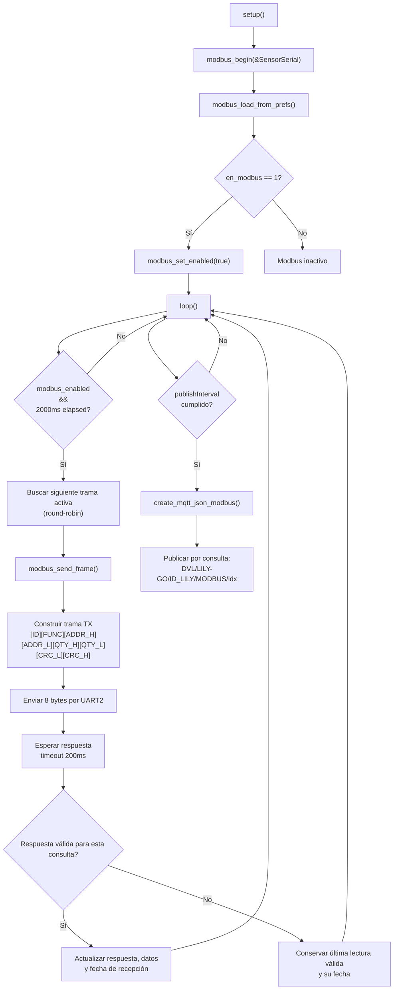
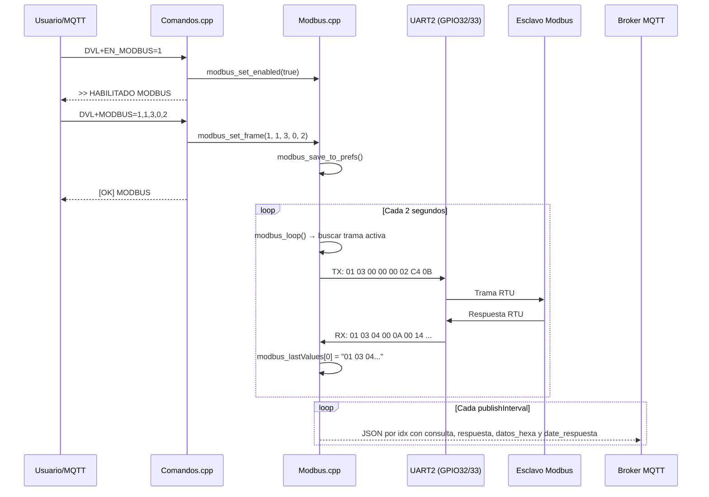

# Análisis de la Implementación Modbus RTU — LILY-GO

## Resumen General

El módulo Modbus implementa un **maestro Modbus RTU** sobre la UART2 de la ESP32. Permite configurar **25 consultas** (idx 1-25), usando `MODBUS_MAX_FRAMES` como límite común entre comandos y módulo. Se ejecuta una consulta por turno, con un intervalo mínimo de 2 segundos. Cada consulta conserva en RAM su última respuesta válida, sus bytes de datos y su fecha UTC de recepción, y se publica en un tópico determinado por su idx.

---

## Arquitectura de Archivos

| Archivo | Rol |
|:---|:---|
| [Modbus.h](Modbus.h) | Definición de API, estructura `ModbusFrameCfg`, constante `MODBUS_MAX_FRAMES` |
| [Modbus.cpp](Modbus.cpp) | Implementación completa: CRC, TX/RX, persistencia, polling |
| [Comandos.cpp](Comandos.cpp) | Procesamiento de comandos de configuración Modbus (por Serial y MQTT) |
| [MQTT.cpp](MQTT.cpp) | Función `create_mqtt_json_modbus()` para armar el JSON de salida |
| [main.ino](main.ino) | Integración: inicialización, loop de polling, envío periódico |

---

## Estructura de Datos

Cada trama configurable se representa con la estructura [ModbusFrameCfg](Modbus.h):

```cpp
typedef struct {
  uint8_t  id;    // Dirección del esclavo Modbus (1-247)
  uint8_t  func;  // Código de función (ej: 0x03 = Read Holding Registers)
  uint16_t addr;  // Dirección de inicio del registro 
  uint16_t qty;   // Cantidad de registros a leer
  bool     used;  // Flag: si esta entrada está activa o vacía
} ModbusFrameCfg;
```

Se mantiene un array estático de 25 posiciones:
```cpp
static ModbusFrameCfg frames[MODBUS_MAX_FRAMES];  // 25 tramas máximo
String modbus_lastValues[MODBUS_MAX_FRAMES];       // Últimas respuestas hex
String modbus_lastData[MODBUS_MAX_FRAMES];         // Datos extraídos sin cabecera ni CRC
String modbus_lastResponseDate[MODBUS_MAX_FRAMES]; // UTC de la última respuesta válida
```

---

## Flujo Completo



---

## Detalle de Cada Componente

### 1. CRC16 Modbus — [modbus_crc16()](Modbus.cpp)

Implementación estándar del CRC-16 Modbus (polinomio `0xA001`, valor inicial `0xFFFF`):
- Se calcula sobre los **6 bytes de payload** (ID + FUNC + ADDR_H + ADDR_L + QTY_H + QTY_L).
- El CRC se agrega al final en formato **little-endian** (byte bajo primero, byte alto después).

### 2. Transmisión y Recepción — [modbus_send_frame()](Modbus.cpp)

**Trama TX (8 bytes):**
```
[Slave_ID] [Function] [Addr_Hi] [Addr_Lo] [Qty_Hi] [Qty_Lo] [CRC_Lo] [CRC_Hi]
```

**Recepción:**
- Espera hasta **200ms** después del envío para leer la respuesta.
- Buffer de lectura: 64 bytes máximo.
- La respuesta completa se convierte a **string hexadecimal con espacios** (ej: `"01 03 04 00 0A 00 14 B8 44"`) y se almacena en `modbus_lastValues[frameIndex]`.
- Solo se actualiza la lectura si coinciden ID, función, longitud y CRC. Para 05/06 también debe coincidir el eco de dirección y valor. Los bytes de datos se guardan en `modbus_lastData[frameIndex]` y se publican como `datos_hexa`, conservando el orden recibido.
- Si no hay respuesta, llega una excepción o una trama inválida, no se reemplaza la lectura anterior ni su fecha. Las tramas recibidas se imprimen en debug aunque se rechacen.
- La fecha de recepción se toma al leer el último byte y se expresa en UTC. Si el reloj no está en el rango 2024-2099 queda vacía, sin asignarla retroactivamente después de sincronizar. No garantiza la precisión del reloj; depende de su sincronización.

> [!IMPORTANT]
> El timeout de lectura es de solo **200ms**. Algunos esclavos Modbus lentos (como medidores de energía o sensores industriales) pueden necesitar hasta 500-1000ms. Si se detectan respuestas vacías frecuentes, este valor debería aumentarse.

### 3. Polling Round-Robin — [modbus_loop()](Modbus.cpp)

- Ejecuta **una sola trama por ciclo** cada `pollIntervalMs = 2000ms` (2 segundos).
- Utiliza un índice rotativo `pollIndex` que avanza circularmente por las 25 posiciones.
- **Solo envía tramas marcadas como `used`**, saltando las entradas vacías.
- Cada ciclo busca la siguiente trama activa a partir de `pollIndex`.

> [!NOTE]
> Con 5 consultas activas cada una se repite aproximadamente cada 10 segundos; con 25, cada 50 segundos. Son mínimos aproximados (`2s × cantidad_de_consultas_activas`): otras tareas pueden demorarlas. Las posiciones vacías se saltan.

Cada consulta publica también al recibir su primera respuesta válida o cuando cambian sus bytes de datos (datos_hexa) respecto de la última respuesta válida de ese idx. Una respuesta igual actualiza date_respuesta sin disparar otro envío; timeout, trama inválida o excepción no disparan el evento. Se conserva el mismo JSON y topic por idx. La publicación periódica por DVL+STIME y el keep-alive siguen independientes. Si el evento no puede publicarse, se intenta encolar en la flash existente, con su límite de 511 bytes por mensaje y su capacidad finita; los paquetes más antiguos pueden sobrescribirse al llenarse la cola. El evento se procesa antes de la siguiente consulta, sin esperar STIME. No se agregan comandos ni se cambia el orden de los datos.

### 4. Persistencia en Flash — [modbus_save_to_prefs()](Modbus.cpp) / [modbus_load_from_prefs()](Modbus.cpp)

Cada trama se serializa como un **blob de 7 bytes** en el namespace `"modbus"` de Preferences. Al actualizar, también se aceptan configuraciones anteriores de 8 bytes y se recuperan los primeros 7:

```
Byte 0: Slave ID
Byte 1: Function Code
Byte 2: Address High
Byte 3: Address Low
Byte 4: Quantity High
Byte 5: Quantity Low
Byte 6: Used flag (0 o 1)
```

Claves: `f1`, `f2`, ... `f25`. Además se persiste el flag `enabled`.

---

## Comandos de Configuración

Todos los comandos se procesan en [Comandos.cpp](Comandos.cpp) y pueden enviarse tanto por **puerto Serial** como por **MQTT** (topic `DVL/LILY-GO/<ID_LILY>/COMANDOS`).

### Comandos de Habilitación

| Comando | Acción | Detalle |
|:---|:---|:---|
| `DVL+EN_MODBUS=1` | **Habilita** Modbus | Deshabilita automáticamente `EN_SERIAL` (exclusión mutua, ya que ambos comparten UART2) |
| `DVL+EN_MODBUS=0` | **Deshabilita** Modbus | — |

> [!WARNING]
> **Exclusión mutua:** Modbus y Serial Secundario comparten el mismo puerto físico (UART2, GPIO32/33). Habilitar uno deshabilita automáticamente al otro. Esto se gestiona en [Comandos.cpp L199-L216](Comandos.cpp).

### Comandos de Configuración de Tramas

La UART2 se configura con `DVL+SBAUD=<baud>` y `DVL+SPARITY_MODBUS=NONE|EVEN|ODD`; se consulta con `DVL+QBAUD` y `DVL+QPARITY_MODBUS`. Ambos valores se guardan en `serial_cfg`, con claves `baud` y `mb_parity`. El baud por defecto es 4800 y la paridad NONE, solo si no hay otro valor guardado. Cambiar uno conserva el otro. Modbus usa 8N1/8E1/8O1; serial común usa 8N1 y al volver a Modbus se recupera su paridad. Se limpian las lecturas de RAM cuando se guarda un baud/paridad realmente diferente, no al consultar ni al repetir el mismo valor.

| Comando | Formato | Descripción |
|:---|:---|:---|
| `DVL+MODBUS=` | `idx,ID,FUNC,ADDR,QTY` | Configura una consulta en el slot `idx` (1-25), que determina el sufijo del tópico MQTT. |
| `DVL+MODBUSCLR=` | `idx` o `ALL` | Borra la trama del slot `idx`, o **todas** con `ALL`. |

**Ejemplo práctico:**
```
DVL+MODBUS=1,1,3,0,2
```
Esto configura el slot #1 para consultar al **esclavo 1**, función **0x03** (Read Holding Registers), dirección de inicio **0x0000** y cantidad **2 registros**.

La trama Modbus RTU que saldrá por UART2 será:
```
01 03 00 00 00 02 C4 0B
└┬┘ └┬┘ └──┬──┘ └──┬──┘ └──┬──┘
 ID  FC   Addr     Qty     CRC
```

> [!NOTE]
> Configuración y borrado validan el número completo antes de convertirlo a `uint8_t`, usando el rango 1-`MODBUS_MAX_FRAMES`. Entradas como 0, 26, 257, vacías, con desbordamiento o texto sobrante se rechazan sin tocar otra consulta. `MODBUSCLR=ALL` conserva el borrado total; `MODBUSCLR=0` se rechaza.

### Comandos de Consulta

| Comando | Respuesta |
|:---|:---|
| `DVL+QEN_MODBUS` | `EN_MODBUS=0` o `EN_MODBUS=1` |
| `DVL+QMODBUS` | Lista por Serial o MQTT las tramas configuradas |

---

## Publicación MQTT

Cuando llega el intervalo de publicación (`publishInterval`) y `en_modbus == 1`, el `main.ino` llama a [create_mqtt_json_modbus()](MQTT.cpp).

El modo de envio Modbus se guarda con `DVL+SENVIO_MODBUS=COLA|DIRECTO` y se consulta con `DVL+QENVIO_MODBUS`. El valor inicial `DIRECTO` conserva la publicacion inmediata con MQTT conectado, aunque exista historico pendiente. En `COLA`, ambos caminos Modbus (cambio de `datos_hexa` y reporte periodico) encolan el JSON al final de la cola global si existe historico pendiente; cuando esta vacia publican directo si MQTT esta conectado. Sin MQTT se sigue guardando en ambos modos. El `while` de descarga historica sigue sin cambios y bloquea temporalmente las consultas Modbus. Los demas tipos de reporte no cambian.

**El JSON resultante tiene esta estructura:**
```json
{
  "topic": "DVL/LILY-GO/60363/MODBUS/3",
  "ident": "60363",
  "baud": 4800,
  "paridad": "EVEN",
  "consulta": "01 03 00 24 00 02 84 00",
  "respuesta": "01 03 04 17 EB 06 99 4C 79",
  "datos_hexa": "17EB0699",
  "date_respuesta": "2026-04-06 10:59:55",
  "date": "2026-04-06 11:00:00",
  "latitud": "-34.603700",
  "longitud": "-58.381600",
  "Tension_backup": 4.15,
  "Tension_principal": 12.3,
  "Version": "V07.19.00",
  "index": 42
}
```

- Se publica un mensaje por consulta. En este ejemplo el idx es 3, aunque el dispositivo consultado tiene ID 1 (primer byte de `consulta`).
- `consulta` se genera con el mismo constructor que la transmisión UART, incluido el CRC. `respuesta` es la última trama válida completa; `datos_hexa` contiene solo sus datos sin espacios, cabecera ni CRC. Reemplazan las claves dinámicas `addr...`.
- `date_respuesta` indica cuándo se recibió el dato válido; `date`, cuándo se armó el mensaje. Un fallo conserva respuesta, datos y fecha anteriores. Antes de la primera respuesta válida quedan vacíos.
- Reconfigurar o borrar una consulta limpia sus tres valores. Cambiar baud o paridad limpia los de todas las consultas. Son datos en RAM y se pierden al reiniciar; los paquetes históricos guardados no se borran.
- El límite offline permanece en 511 bytes de contenido por paquete y los buffers JSON/MQTT mantienen sus tamaños anteriores. Los mensajes ya encolados conservan su formato y tópico previos.

**Topic de publicación:** `DVL/LILY-GO/<ID_LILY>/MODBUS/<idx>`

El sufijo se expresa en decimal y ahora identifica la consulta, no el dispositivo.
Varias consultas al mismo esclavo tienen tópicos independientes, incluso si
comparten dirección, función o cantidad. El servidor debe adaptar su interpretación.
La respuesta de lectura no incluye dirección inicial: ID, función, longitud y CRC
no permiten distinguir por sí solos toda respuesta tardía del mismo dispositivo.
En esta modificación se mantiene el manejo temporal de UART, sin nuevos comandos
de espera ni cambios en los 200 ms de timeout o los 2 segundos de polling.

---

## Integración en main.ino

### Inicialización (setup)
```cpp
modbus_begin(&SensorSerial);     // Asocia UART2 al módulo Modbus
modbus_load_from_prefs();        // Carga tramas guardadas en flash

if (en_modbus) {
    modbus_set_enabled(true);
    en_serial = 0;               // Exclusión mutua con Serial
}
```

### Loop principal
```cpp
// Ciclo de polling Modbus (cada 2s, una trama por vez)
if (en_modbus && modbus_get_enabled()) {
    modbus_loop();
}

// Publicación periódica MQTT (cada publishInterval segundos)
if (en_modbus == 1) {
    for (cada idx configurado) {
        String topicModbus = topic1 + "/MODBUS/" + String(idx);
        String jsonmodbus = create_mqtt_json_modbus(..., idx);
        if (mqtt.connected()) {
            publish_mqtt_json(topicModbus, jsonmodbus);
        } else {
            flash_save_packet(jsonmodbus.c_str());  // Guarda offline
        }
    }
}
```

---

## Diagrama de Secuencia



---

## Resumen de Puntos Clave

| Aspecto | Valor/Detalle |
|:---|:---|
| **Puerto físico** | UART2 (RX=GPIO32, TX=GPIO33), 4800 baud |
| **Protocolo** | Modbus RTU (binario con CRC16) |
| **Max tramas** | 25, tanto en el módulo como en los comandos |
| **Polling** | Round-robin, 1 trama cada 2s |
| **Timeout RX** | 200ms |
| **Persistencia** | Flash (Preferences, namespace `"modbus"`) |
| **Exclusión mutua** | Con `EN_SERIAL` (comparten UART2) |
| **Buffer RX** | 64 bytes |
| **Formato respuesta** | String hexadecimal crudo |

## Límites actuales

- La persistencia de consultas aún no verifica el resultado de cada escritura. Una comprobación de recuperación tras reiniciar no equivale a simular fallos de escritura o pérdida de alimentación durante el guardado.
- La respuesta de lectura no permite identificar por sí sola toda trama tardía de otro turno con mismo ID, función y cantidad. El colector actual no separa varias respuestas acumuladas y mantiene su ventana fija de 200 ms. Las mejoras de recepción y el comando de timeout quedan pendientes.
- El buffer RX de 64 bytes permite respuestas de lectura 03/04 de hasta 29 registros por tamaño (63 bytes); la velocidad y el tiempo de respuesta pueden imponer un máximo menor. La validación genérica actual extrae datos de funciones 01-06; no implica soporte universal de cualquier función Modbus ingresada al comando.
- Además del idx, el comando tiene campos ID, función, dirección y cantidad cuya validación de rangos/texto no se amplió en este trabajo. La conversión usa base automática (`strtol` con base 0): evitar ceros iniciales en valores decimales, porque se interpretan como octales. Utilizar `8` o `0x08` para ocho; no `08`.
- El indicador de fecha admite años 2024-2099 y no certifica precisión absoluta ni sincronización reciente del reloj. El fix UTC existente se conserva. Los tamaños JSON/MQTT y el límite flash de 512 bytes no se modifican en esta revisión.
